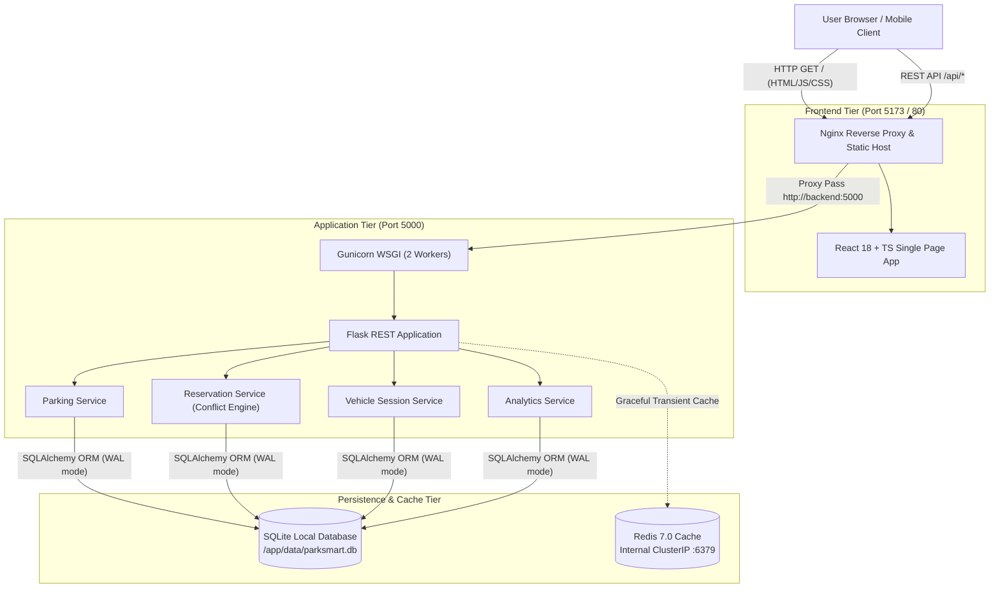
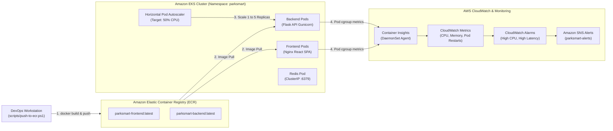

# ParkSmart — Smart Parking Management System

> **Tagline:** *"Find a Spot. Park Smarter."*  
> **Course:** BTech Fundamentals of Cloud Computing — Lab #2  
> **Stack:** React, TypeScript, Vite, Tailwind CSS, Python Flask, Gunicorn, SQLite, Redis, Docker, Amazon ECR, Amazon EKS, Kubernetes HPA, CloudWatch

---

## 1. System Overview

**ParkSmart** is a production-engineered, cloud-ready Smart Parking Management application. Designed for single-command local execution with **Docker Compose** and horizontally scalable cloud deployment on **Amazon Elastic Kubernetes Service (EKS)** with **Horizontal Pod Autoscaling (HPA)**, **Container Insights**, and **CloudWatch Alarms**.

### Core Capabilities
- **Real-Time Interactive Slot Grid**: Visual matrix across 4 zones and 3 floors with live status indicators (Available, Reserved, Occupied, Out of Service).
- **Transactional Double-Booking Prevention**: High-integrity reservation engine with time-window conflict detection.
- **Simulated Gate Operations**: Vehicle arrival and exit gates, license plate logging, duration calculation, and automated fee assessment.
- **Administrative Telemetry**: Real-time KPI cards, occupancy distribution charts, reservation auditing, and dynamic inventory management.
- **Enterprise Cloud Observability**: Standard container metrics and custom application instrumentation exposed via `/api/metrics` and `/api/health`.

---

## 2. Architecture Diagrams

### 2.1 Request Flow Architecture



### 2.2 AWS Cloud Deployment & Observability Pipeline



---

## 3. Quick Start — Local Execution

### 3.1 Prerequisites
- Docker Desktop with Docker Compose v2.0+
- Web browser (Chrome, Firefox, Edge)

### 3.2 Single-Command Execution
From the root workspace directory, run:

```bash
# Start all containers in detached mode with automated rebuild
docker compose up --build -d
```

### 3.3 Service Endpoints

| Component | Target URL | Description |
| :--- | :--- | :--- |
| **Frontend Application** | [http://localhost:5173](http://localhost:5173) | Interactive React User & Admin Dashboard |
| **Backend REST API** | [http://localhost:5000](http://localhost:5000) | Python Flask API root |
| **API Health Check** | [http://localhost:5000/api/health](http://localhost:5000/api/health) | Application liveness probe |
| **API Readiness Check** | [http://localhost:5000/api/ready](http://localhost:5000/api/ready) | DB connectivity readiness probe |
| **Telemetry & Metrics** | [http://localhost:5000/api/metrics](http://localhost:5000/api/metrics) | Request latency and counter metrics |

### 3.4 Operational Inspection Commands

```bash
# View active container status
docker compose ps

# Follow logs across all containers
docker compose logs -f

# Follow backend logs specifically
docker compose logs -f backend

# Follow frontend access logs
docker compose logs -f frontend

# Gracefully stop the application without deleting database volume
docker compose down

# Stop and wipe persistent database volume for a clean state
docker compose down -v
```

---

## 4. REST API Endpoints Reference

| Method | Endpoint | Description |
| :--- | :--- | :--- |
| `GET` | `/api/health` | Liveness check returning status, timestamp, and version |
| `GET` | `/api/ready` | Readiness check verifying SQLite database and Redis connectivity |
| `GET` | `/api/info` | Application metadata and runtime environment info |
| `GET` | `/api/metrics` | In-memory telemetry: request count, error count, avg latency |
| `GET` | `/api/spaces/` | List all parking slots (filters: `status`, `zone`, `vehicle_type`) |
| `GET` | `/api/spaces/<id>` | Retrieve specific slot details |
| `POST` | `/api/spaces/` | Create a new parking space |
| `PUT` | `/api/spaces/<id>` | Update parking space attributes (floor, rate, vehicle type) |
| `PATCH`| `/api/spaces/<id>/status` | Update slot operational status |
| `GET` | `/api/reservations/` | List reservations (filters: `status`, `date`) |
| `GET` | `/api/reservations/<id>` | Get specific reservation details |
| `POST` | `/api/reservations/` | Create reservation with strict collision prevention |
| `PATCH`| `/api/reservations/<id>/cancel` | Cancel active reservation and release slot |
| `GET` | `/api/vehicles/active` | Get currently parked active vehicles |
| `GET` | `/api/vehicles/history` | Paginated completed vehicle checkout sessions |
| `POST` | `/api/vehicles/entry` | Record vehicle arrival gate simulation |
| `POST` | `/api/vehicles/exit` | Process vehicle departure gate and compute fee |
| `GET` | `/api/analytics/overview` | Aggregated dashboard KPI counters |
| `GET` | `/api/analytics/occupancy` | Historical occupancy trend for last N days |
| `GET` | `/api/analytics/revenue` | Simulated revenue trend from completed sessions |
| `GET` | `/api/system/status` | Full system health report |

---

## 5. Amazon ECR & EKS Deployment Workflow

### 5.1 Push to Amazon ECR
The included PowerShell script dynamically inspects your AWS CLI identity, ensures ECR repositories exist, builds multi-stage container images, and pushes them:

```powershell
# Safe non-hardcoded execution
.\scripts\push-to-ecr.ps1 -Region us-east-1 -Tag latest
```

### 5.2 Kubernetes Manifests Application
All Kubernetes manifests are isolated in the `parksmart` namespace within `k8s/`:

```bash
# 1. Update image URIs in k8s/04-backend-deployment.yaml and k8s/05-frontend-deployment.yaml
# 2. Create the production secret template:
kubectl create secret generic parksmart-secrets \
  --from-literal=SECRET_KEY="$(openssl rand -hex 32)" \
  -n parksmart

# 3. Apply all manifests in order:
kubectl apply -f k8s/

# 4. Verify pod scheduling and health:
kubectl get pods -n parksmart -o wide
kubectl get services -n parksmart
kubectl get hpa -n parksmart
```

### 5.3 Horizontal Pod Autoscaler (HPA) Verification
The backend deployment is bound to an HPA target:
- **Min Replicas:** 1
- **Max Replicas:** 5
- **Target CPU Utilization:** 50%

Run the automated load test to observe auto-scaling:
```powershell
# In Terminal 1: Monitor HPA scaling
kubectl get hpa parksmart-backend-hpa -n parksmart --watch

# In Terminal 2: Generate load
.\scripts\load-test.ps1 -TargetUrl http://localhost:5000 -Requests 500 -Concurrency 10
```

---

## 6. Project Documentation Index

- [Architecture Guide](docs/architecture.md) — Detailed design, component breakdown, and database schema.
- [AWS Deployment Guide](docs/aws-deployment.md) — Step-by-step EKS, ECR, and RDS setup walkthrough.
- [Monitoring & Observability Guide](docs/monitoring.md) — Container Insights, CloudWatch Alarms, and SNS setup.
- [Troubleshooting & Operations Guide](docs/troubleshooting.md) — Diagnostics for ports, Docker, and Kubernetes errors.
- [Lab Reflection & Conceptual Answers](docs/lab-answers.md) — Answers to all 5 required lab examination questions.

---

## 7. Lab Submission Checklist

- [x] **GitHub Repository**: Complete codebase committed with clean history and `.gitignore`.
- [x] **Architecture Diagrams**: Mermaid diagrams for request flow and deployment pipeline.
- [x] **Docker Configuration**: Multi-stage `Dockerfile` (frontend & backend) and `docker-compose.yml`.
- [x] **Amazon ECR Script**: Dynamic non-hardcoded `scripts/push-to-ecr.ps1`.
- [x] **EKS Deployments & Services**: Complete `k8s/` manifests with namespace, configmaps, and secrets.
- [x] **Kubernetes HPA Manifest**: CPU target 50% with min 1 and max 5 replicas.
- [x] **CloudWatch Monitoring Plan**: Documented in `docs/monitoring.md`.
- [x] **Load Testing Script**: PowerShell load generator with latency & P95 metrics (`scripts/load-test.ps1`).
- [x] **Reflection Questions**: Comprehensive answers in `docs/lab-answers.md`.
- [x] **Automated Tests**: 28 passing backend pytest tests covering health, spaces, bookings, and exit.
