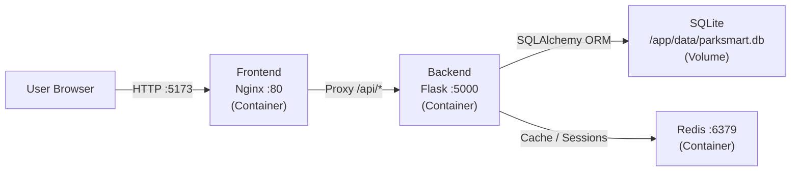
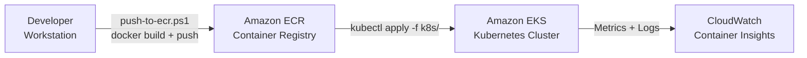

# ParkSmart Architecture

## System Overview

ParkSmart is a containerized three-tier web application for smart parking management. It is designed to run locally with Docker Compose and scale in the cloud using Amazon EKS (Elastic Kubernetes Service).

The system consists of three primary services:

- **Frontend**: A React single-page application served by Nginx. It provides the parking dashboard, space availability map, reservation management, and analytics views.
- **Backend**: A Python Flask REST API that handles all business logic — parking space CRUD, reservations, vehicle tracking, and analytics aggregation.
- **Redis**: An in-memory data store used for caching API responses, rate limiting, and session management.

Data is persisted to SQLite in local/demo mode. For multi-replica production deployments, the backend connects to Amazon RDS PostgreSQL via the `DATABASE_URL` environment variable.

---

## Diagram 1: Request Flow

**Flow description:**
1. The user's browser connects to the Nginx container on port 5173 (Docker Compose) or port 80 (Kubernetes).
2. Nginx serves the React SPA for all non-API routes.
3. Requests to `/api/*` are proxied by Nginx to the Flask backend on port 5000.
4. Flask reads and writes parking data to SQLite (or RDS PostgreSQL in production) via SQLAlchemy.
5. Redis is used for caching space availability data, storing rate-limit counters, and managing user sessions.

---

## Diagram 2: Deployment Pipeline

**Pipeline description:**
1. The developer runs `push-to-ecr.ps1` on their workstation to build Docker images and push them to Amazon ECR.
2. The developer updates the image URIs in the `k8s/04-backend-deployment.yaml` and `k8s/05-frontend-deployment.yaml` manifests.
3. `kubectl apply -f k8s/` applies all manifests to the EKS cluster, creating the namespace, config, deployments, services, and HPA.
4. The running pods emit metrics and logs to CloudWatch Container Insights for observability.

---

## Component Descriptions

### Frontend Container
- **Base image**: `node:20-alpine` (build stage) → `nginx:alpine` (runtime)
- **Build tool**: Vite compiles and bundles the React app to static files
- **Runtime**: Nginx serves static assets and proxies `/api/*` to the backend service
- **Port**: 80 (container), mapped to 5173 locally

### Backend Container
- **Base image**: `python:3.11-slim`
- **Framework**: Flask with Blueprints for modular routing
- **ORM**: SQLAlchemy (SQLite locally, PostgreSQL in production)
- **Port**: 5000
- **Health endpoints**: `/api/health` (liveness), `/api/ready` (readiness)

### Redis Container
- **Image**: `redis:7-alpine`
- **Persistence**: AOF (Append Only File) enabled via `--appendonly yes`
- **Memory limit**: 128 MB with `allkeys-lru` eviction policy
- **Exposure**: ClusterIP only — never exposed outside the cluster

---

## Database Schema

| Table         | Key Columns                                              | Description                         |
|---------------|----------------------------------------------------------|-------------------------------------|
| `spaces`      | `id`, `name`, `zone`, `type`, `status`, `hourly_rate`    | Parking space definitions           |
| `vehicles`    | `id`, `license_plate`, `owner_name`, `vehicle_type`      | Registered vehicle records          |
| `reservations`| `id`, `space_id`, `vehicle_id`, `start_time`, `end_time`, `status` | Booking records            |
| `transactions`| `id`, `reservation_id`, `amount`, `payment_method`, `timestamp` | Payment records             |

Relationships:
- A `space` can have many `reservations` (one-to-many)
- A `vehicle` can have many `reservations` (one-to-many)
- Each `reservation` has one `transaction` (one-to-one)

---

## API Design Principles

1. **RESTful routes**: Resources are nouns; HTTP methods define actions (`GET /api/spaces`, `POST /api/reservations`).
2. **JSON responses**: All responses use `Content-Type: application/json`.
3. **Health probes**: `/api/health` returns `{"status": "ok"}` for Kubernetes liveness; `/api/ready` checks DB and Redis connectivity for readiness.
4. **Error format**: Errors return `{"error": "message", "code": <http_status>}`.
5. **CORS**: Controlled by the `CORS_ORIGINS` environment variable.
6. **Rate limiting**: Handled at the Redis layer to prevent abuse.

---

## Scalability Notes

### SQLite Limitation
SQLite uses file-level locking and does not support concurrent writes from multiple processes. It is suitable only for:
- Local development with `docker compose`
- Single-replica Kubernetes demos

**Do not** increase backend replicas beyond 1 while using SQLite. Concurrent writes will cause `database is locked` errors.

### RDS PostgreSQL Migration
For multi-replica production deployments:
1. Provision an Amazon RDS PostgreSQL instance in the same VPC as the EKS cluster.
2. Update `DATABASE_URL` in `k8s/01-configmap.yaml` to the RDS endpoint.
3. Store the full URL (including credentials) in `k8s/02-secrets-template.yaml` or AWS Secrets Manager.
4. Increase backend `replicas` in `k8s/04-backend-deployment.yaml` to 2–5.
5. HPA will then scale between `minReplicas: 1` and `maxReplicas: 5` based on CPU utilization.

### Redis Scaling
The current Redis deployment is a single instance (no cluster mode). For production:
- Use Amazon ElastiCache for Redis (managed, multi-AZ)
- Update `REDIS_URL` in the ConfigMap to the ElastiCache endpoint
