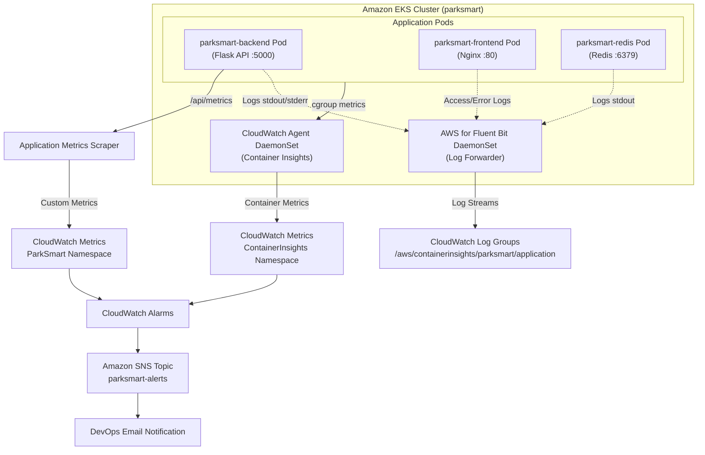

# ParkSmart — CloudWatch & Container Insights Monitoring Guide

This guide details the observability strategy for the ParkSmart Smart Parking Management System deployed on Amazon EKS, covering infrastructure monitoring, container insights, custom application metrics, and alerting.

---

## 1. Overview of Monitoring Architecture

ParkSmart's monitoring architecture operates on three distinct layers:



---

## 2. Distinction: AWS Standard vs. Custom Application Metrics

It is vital to distinguish between out-of-the-box infrastructure metrics and custom metrics emitted by the ParkSmart application:

| Metric Type | Source | Examples | Setup Required |
| :--- | :--- | :--- | :--- |
| **AWS Standard / Container Insights** | CloudWatch Container Insights DaemonSet | `node_cpu_utilization`, `pod_cpu_utilization`, `pod_memory_working_set`, `pod_number_of_container_restarts`, `pod_status_ready` | Enable Container Insights addon on EKS |
| **Custom Application Metrics** | ParkSmart Flask API (`/api/metrics`) | `http_requests_total`, `http_5xx_errors_total`, `http_request_duration_ms_avg`, `active_parking_sessions`, `total_reservations` | CloudWatch Embedded Metric Format (EMF) or scraper |

> [!IMPORTANT]
> Standard CloudWatch metrics will not reflect HTTP status codes (such as 500 errors) or API route-specific latencies unless you deploy the AWS Distro for OpenTelemetry (ADOT) or scrape the `/api/metrics` endpoint into CloudWatch via the CloudWatch agent.

---

## 3. Container Insights Setup on Amazon EKS

### 3.1 Prerequisites
1. Amazon EKS cluster running Kubernetes 1.28+.
2. IAM Role for Service Accounts (IRSA) with policy `CloudWatchAgentServerPolicy`.

### 3.2 Installation with AWS CLI & Helm / Manifests

Attach IAM policy to the EKS worker nodes or configure IRSA:
```bash
aws iam attach-role-policy \
  --role-name <EKS-NodeInstanceRole-Name> \
  --policy-arn arn:aws:iam::aws:policy/CloudWatchAgentServerPolicy
```

Deploy the CloudWatch Agent and Fluent Bit DaemonSets:
```bash
# Set Cluster Name and Region
ClusterName="parksmart-cluster"
Region="us-east-1"

# Apply the official CloudWatch Container Insights manifest
curl -s https://raw.githubusercontent.com/aws-samples/amazon-cloudwatch-container-insights/latest/k8s-deployment-manifest-templates/deployment-mode/daemonset/container-insights-monitoring/quickstart/cwagent-fluent-bit-quickstart.yaml | \
sed "s/{{cluster_name}}/$ClusterName/;s/{{region_name}}/$Region/" | \
kubectl apply -f -
```

Verify DaemonSet execution:
```bash
kubectl get pods -n amazon-cloudwatch
```

---

## 4. Key Metrics Monitored

### 4.1 Cluster & Pod Infrastructure Metrics
- `pod_cpu_utilization`: Average CPU utilized divided by CPU requested. Triggers HPA scaling when exceeding 50%.
- `pod_memory_working_set`: Working memory used by the Python and Nginx processes. Used to detect memory leaks.
- `pod_number_of_container_restarts`: Detects crashing Python processes, OOM-kills, or unhandled exceptions.
- `service_number_of_running_pods`: Verifies active replica counts for `parksmart-backend` and `parksmart-frontend`.

### 4.2 Application Instrumentation (`/api/metrics`)
The ParkSmart backend exposes runtime metrics at `GET /api/health` and `GET /api/metrics`:
```json
{
  "request_count": 1420,
  "error_count": 2,
  "avg_latency_ms": 14.8,
  "uptime_seconds": 3600,
  "db_spaces_count": 40,
  "active_sessions": 8
}
```

---

## 5. CloudWatch Alarms Specification

| Alarm Name | Metric Monitored | Threshold / Evaluation | Action |
| :--- | :--- | :--- | :--- |
| `ParkSmart-Backend-HighCPU` | `pod_cpu_utilization` (`parksmart-backend`) | > 80% for 3 consecutive periods of 1 min | Send SNS alert; HPA auto-scales pods |
| `ParkSmart-Backend-HighMemory` | `pod_memory_working_set` | > 400 MiB for 2 consecutive periods of 5 min | Send SNS alert (investigate memory leaks) |
| `ParkSmart-Backend-PodRestarts` | `pod_number_of_container_restarts` | > 2 in 10 minutes | Send SNS alert to On-Call engineer |
| `ParkSmart-API-Elevated5xx` | `http_5xx_errors_total` | > 5 errors in 5 minutes | Send High-Priority SNS alert |
| `ParkSmart-API-HighLatency` | `avg_latency_ms` | > 250 ms for 5 minutes | Send SNS alert (DB query bottleneck) |

### Creating Alarms via AWS CLI Example

```bash
# High CPU Alarm for Backend
aws cloudwatch put-metric-alarm \
  --alarm-name "ParkSmart-Backend-HighCPU" \
  --alarm-description "Triggers when backend pod CPU exceeds 80%" \
  --metric-name pod_cpu_utilization \
  --namespace ContainerInsights \
  --statistic Average \
  --period 60 \
  --evaluation-periods 3 \
  --threshold 80 \
  --comparison-operator GreaterThanThreshold \
  --dimensions Name=ClusterName,Value=parksmart-cluster Name=Namespace,Value=parksmart Name=PodName,Value=parksmart-backend \
  --alarm-actions arn:aws:sns:us-east-1:<ACCOUNT_ID>:parksmart-alerts
```

---

## 6. Amazon SNS Notification Setup

1. Create SNS Topic:
   ```bash
   aws sns create-topic --name parksmart-alerts
   ```
2. Subscribe DevOps email address:
   ```bash
   aws sns subscribe \
     --topic-arn arn:aws:sns:us-east-1:<ACCOUNT_ID>:parksmart-alerts \
     --protocol email \
     --notification-endpoint devops-team@example.com
   ```
3. Confirm subscription via the email verification link received.

---

## 7. CloudWatch Logs & Retention Policy

By default, Container Insights streams pod logs into `/aws/containerinsights/parksmart/application`.

To prevent excessive CloudWatch log storage costs, set retention to 14 or 30 days:
```bash
aws logs put-retention-policy \
  --log-group-name "/aws/containerinsights/parksmart/application" \
  --retention-in-days 14
```

---

## 8. Estimated Monthly Monitoring Cost (AWS Lab Environment)

| Component | Usage / Free Tier Allowance | Est. Monthly Cost (USD) |
| :--- | :--- | :--- |
| **Container Insights Metrics** | 8 custom metrics per pod (~24 metrics total) | ~$7.20 ($0.30/metric) |
| **CloudWatch Alarms** | 5 standard alarms | $0.50 ($0.10/alarm) |
| **CloudWatch Logs** | ~2 GB ingestion + 14-day storage | ~$1.20 ($0.50/GB) |
| **Amazon SNS** | < 1,000 email notifications | $0.00 (Free Tier) |
| **Total Estimated Cost** | — | **~$8.90 / month** |

> [!TIP]
> In an academic lab setting, destroy the EKS cluster and CloudWatch log groups immediately after completing evaluation to incur negligible fractions of a dollar.

